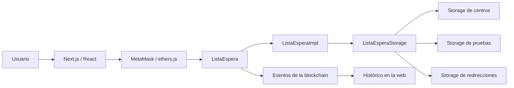
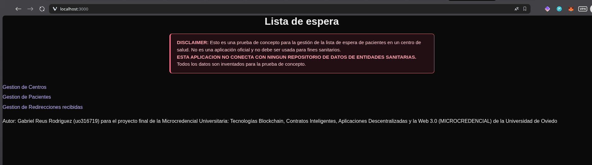
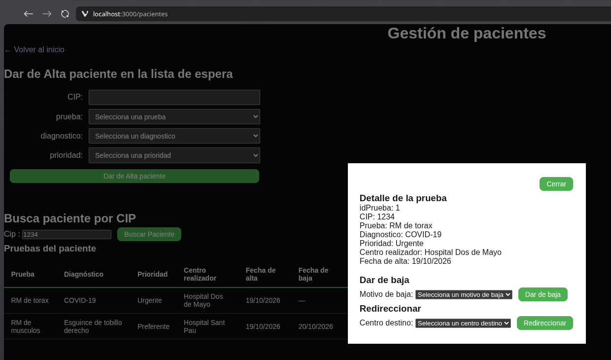
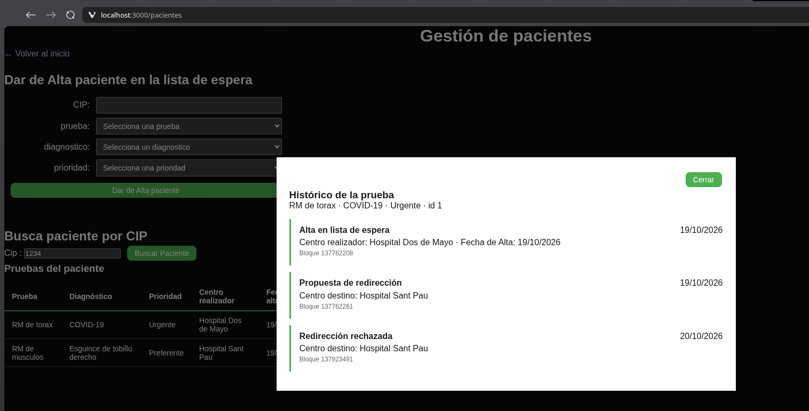
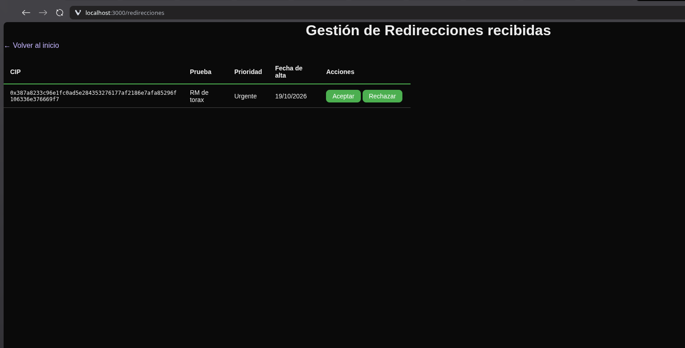

# Lista de espera sanitaria con blockchain

Prueba de concepto académica para gestionar una lista de espera simplificada de pruebas diagnósticas. El repositorio reúne una aplicación web dinámica en Next.js y contratos inteligentes escritos en Solidity. Gabriel Reus Rodríguez desarrolló y entregó el proyecto como trabajo final de la microcredencial universitaria **Tecnologías Blockchain, Contratos Inteligentes, Aplicaciones Descentralizadas y la Web 3.0** de la Universidad de Oviedo.

> **Aviso:** no es una aplicación oficial ni debe utilizarse para prestar servicios sanitarios. No se conecta a sistemas de entidades sanitarias y las capturas contienen datos ficticios. Los datos escritos en una blockchain pública pueden ser consultados y permanecer allí; el hash del CIP no garantiza anonimato. No introduzcas datos reales de pacientes.

## Componentes

| Carpeta | Contenido |
|---|---|
| [`frontend/lista-espera`](frontend/lista-espera/) | Aplicación web Next.js/React. Conecta con una cartera compatible con MetaMask y llama a los contratos usando ethers.js. |
| [`blockchain`](blockchain/) | Contratos Solidity, interfaces, almacenamiento, scripts de despliegue y pruebas. |
| [`img`](img/) | Capturas ilustrativas de las pantallas de la aplicación. |

La aplicación ofrece gestión de centros, altas y bajas de pruebas, búsqueda de pruebas por CIP, consulta del detalle e histórico de eventos, y propuestas de redirección entre centros. El centro destinatario puede aceptar o rechazar una redirección pendiente.

## Arquitectura

La web firma las transacciones con la cartera del usuario. `ListaEspera` actúa como punto de entrada, reenvía las operaciones a `ListaEsperaImpl` y esta delega la persistencia en `ListaEsperaStorage` y sus contratos especializados. El histórico de la web se construye leyendo los eventos emitidos por el contrato.



El script de despliegue crea y enlaza el contrato de entrada, la implementación, el almacenamiento principal y los tres contratos de almacenamiento especializados. Consulta [`blockchain/Planning.md`](blockchain/Planning.md) para el planteamiento funcional y [`blockchain/contracts`](blockchain/contracts/) para el código.

## Capturas

Las imágenes muestran datos de ejemplo y no representan información clínica real.

**Inicio**



**Alta y gestión de pruebas**



**Histórico de eventos**



**Redirecciones pendientes**



## Requisitos

- Node.js y npm para instalar y ejecutar la aplicación web.
- Una cartera de navegador compatible con MetaMask.
- Remix IDE para compilar y desplegar los contratos mediante el script incluido.
- Una red compatible con el despliegue. La configuración actual del front-end apunta a BNB Smart Chain Testnet (Chapel); comprueba la red y las direcciones antes de usarlo.

## Ejecutar la aplicación web

Desde la raíz del repositorio:

```bash
cd frontend/lista-espera
npm ci
npm run dev
```

Abre [http://localhost:3000](http://localhost:3000). La aplicación ofrece las vistas de inicio, gestión de centros, gestión de pacientes y redirecciones recibidas.

Para generar y servir la versión de producción:

```bash
cd frontend/lista-espera
npm run build
npm run start
```

## Uso de la DApp

Antes de usarla, despliega los contratos, configura en el front-end la dirección de `ListaEspera` y su ABI, y abre la aplicación con MetaMask instalada y conectada a la misma red. La configuración actual apunta a BNB Smart Chain Testnet (Chapel). Usa cuentas de prueba con fondos para pagar el gas; las operaciones que modifican la blockchain requieren confirmar la transacción en MetaMask.

Desde la página de inicio puedes entrar en las siguientes áreas:

1. **Gestión de centros:** consulta los centros registrados y, con la cuenta autorizada para administrar centros, registra nuevos centros indicando su nombre y dirección de cartera.
2. **Gestión de pacientes:** registra una prueba indicando el CIP, el tipo de prueba, el diagnóstico y la prioridad. Para consultar las pruebas existentes, vuelve a introducir el mismo CIP y pulsa **Buscar Paciente**. La aplicación calcula su hash tanto al dar de alta como al buscar; aun así, no se debe interpretar como anonimización ni introducir datos reales.
3. **Detalle e histórico:** desde los resultados puedes abrir la gestión de una prueba o consultar su histórico de eventos, que la aplicación lee de la blockchain.
4. **Gestión de una prueba:** la cartera del centro que figura como realizador puede dar de baja la prueba seleccionando un motivo o proponer su redirección a otro centro activo. La propuesta queda pendiente de respuesta.
5. **Gestión de redirecciones recibidas:** el centro de destino consulta las propuestas pendientes y puede aceptarlas o rechazarlas. La transacción debe firmarse desde la cartera del centro destinatario.

La interfaz muestra mensajes de error si la cartera, la red, el contrato o los permisos no permiten completar una operación. Las capturas de [la sección siguiente](#capturas) ilustran las pantallas con datos ficticios. Este recorrido representa únicamente una demostración académica: la DApp no presta servicios sanitarios ni consulta sistemas de centros de salud.

## Compilar y desplegar los contratos

El flujo incluido usa Remix y el entorno de ejecución de scripts de Remix; no hay un proyecto Hardhat independiente con configuración y comandos propios en `blockchain/`.

1. Abre Remix IDE y carga los contratos de `blockchain/contracts/` y los scripts de `blockchain/scripts/`.
2. Selecciona un compilador Solidity compatible con `pragma ^0.8.10` y compila los contratos.
3. En **Deploy & Run Transactions**, conecta la cartera y selecciona la red de destino. La cuenta desplegadora se convierte en administrador.
4. Ejecuta `deploy_listaEspera_with_ethers.ts` desde el explorador de archivos de Remix. El script despliega y enlaza los seis contratos; conserva las direcciones que imprime al finalizar.
5. Configura la dirección del contrato `ListaEspera` en el front-end antes de usar la aplicación.

El script espera encontrar los artefactos compilados en `browser/artifacts/`, como se indica en [`blockchain/scripts/ethers-lib.ts`](blockchain/scripts/ethers-lib.ts). Sigue las instrucciones del entorno de Remix si cambia la ubicación de esos artefactos.

## Configuración del front-end

Actualmente la dirección de `ListaEspera` está escrita directamente en las páginas `centros.js`, `pacientes.js` y `redirecciones.js`. Tras desplegar en otra red, actualiza esa dirección en las tres páginas y confirma que `src/contracts/ListaEspera.json` contiene el ABI correspondiente al contrato desplegado.

La consulta del histórico usa además un proveedor RPC configurado en `pacientes.js`. Debe corresponder a la misma red y contrato. El proyecto no define variables de entorno para estas direcciones; no compartas credenciales RPC privadas ni las subas al repositorio.

La aplicación solicita acceso a la cartera al abrir las pantallas que interactúan con la blockchain. Usa la cuenta de un centro registrado para las operaciones del centro y la cuenta autorizada por el contrato para administrar centros. Las transacciones requieren fondos de prueba para pagar el gas de la red seleccionada.

## Pruebas

Hay pruebas Solidity y TypeScript en [`blockchain/tests`](blockchain/tests/), incluidas pruebas de almacenamiento y de la lógica de `ListaEsperaImpl`. Sin embargo, la carpeta `blockchain/` no contiene un manifiesto de dependencias ni una configuración autónoma de Hardhat, por lo que este repositorio no proporciona un comando reproducible único para ejecutarlas. La compilación y ejecución dependen de la configuración de Remix o Hardhat disponible en el entorno de desarrollo.

## Licencias

El front-end y los contratos incluyen licencia MIT: [`frontend/LICENSE`](frontend/LICENSE) y [`blockchain/LICENSE`](blockchain/LICENSE).
